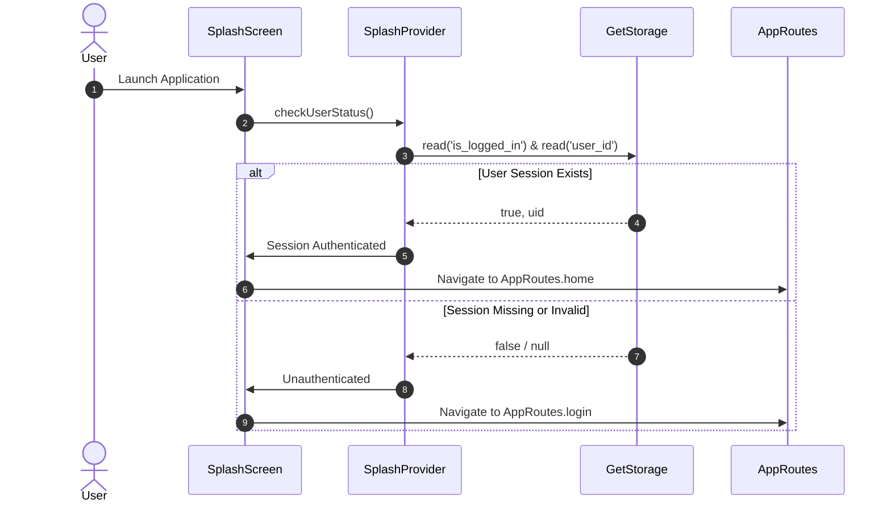
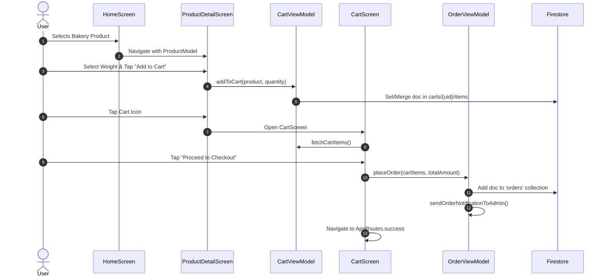

# Application Overview & Reverse-Engineering Specification: HomeBake

> **Document Type:** System Architecture & Functional Specification  
> **Target Project:** `HomeBake` (Flutter Mobile & Web Client)  
> **Status:** Production / Active Development Baseline  
> **Purpose:** Official technical baseline for brand-independent rebranding, UX modernization, and structural preservation.

---

## 1. Executive Summary

**HomeBake** is a multi-platform e-commerce application built in Flutter designed for home-based bakeries and artisanal confectioners. It connects artisanal bakers with local customers looking to discover, customize, and order freshly baked goods, artisanal pastries, and specialty desserts.

* **Target Audience:** Confectionery enthusiasts, local dessert buyers, and gift shoppers seeking customized, made-to-order baked goods.
* **Core Value Proposition:** Direct catalog browsing by category, real-time cart and subtotal calculation, order tracking with status milestones and QR code verification, and user profile management.
* **Operational Model:** Direct-to-consumer digital ordering with backend order intake, push notification broadcasts to administrators/bakers via Firebase Cloud Messaging (FCM), and localized order tracking.

---

## 2. Current Product Scope

### 2.1 Core Implemented Features
1. **Authentication & Session Persistence:** Email/password registration, login, logout, password reset, and persistent local session caching via `GetStorage`.
2. **Product Catalog & Discovery:** Categorized catalog browsing (`categories` collection), search filtering, hot picks/popular offerings banner display, and detailed product view with dynamic pricing.
3. **Shopping Cart & Checkout Flow:** Item addition with customizable quantity/weight calculations, Firestore sub-collection cart synchronization (`carts/{uid}/items`), real-time item counter, and multi-step order placement.
4. **Order Management & Tracking:** Historical order listing (`orders` collection), status-tagged timeline (Pending, Processing, Delivered, Cancelled), and an Order Detail screen featuring dynamic order QR generation for fulfillment verification.
5. **User Profile & Address Management:** User document synchronization (`Users` collection), profile picture updates, full name and phone number editing, and stored delivery addresses.

### 2.2 Supporting & Partial Features
1. **Push Notifications:** Device token registration with Firestore (`token` field on `Users`) and FCM topic subscription (`orders`). Background notification handling and direct client-side FCM HTTP v1 administrative dispatch.
2. **Settings Hub:** Screen container with options for password changes, reviews, support, notifications, language, and account deletion (currently UI placeholders without bound business logic).
3. **Inventory Management Logic:** In-code inventory decrement methods (`updateInventory`), though currently unlinked to the cart checkout trigger.

---

## 3. Technology Stack

| Layer / Concern | Technology / Package | Version / Constraint | Verified Purpose |
| :--- | :--- | :--- | :--- |
| **Language & SDK** | Dart / Flutter | Flutter SDK `^3.5.3` / Dart `3.x` | Cross-platform UI foundation |
| **State Management** | `provider` | `^6.1.2` | Reactive state management (`ChangeNotifierProvider`, `MultiProvider`) |
| **Local Persistence** | `get_storage` | `^2.1.1` | Key-value session token and user profile storage |
| **Backend & Cloud** | Firebase Core / Auth / Firestore | `firebase_core: ^3.6.0`, `firebase_auth: ^5.3.1`, `cloud_firestore: ^5.4.3` | Authentication, document database, and real-time streams |
| **Push Notifications** | `firebase_messaging`, `flutter_local_notifications` | `^15.1.3`, `^17.2.2` | Remote push notification handling & local banner presentation |
| **Google Cloud Auth** | `googleapis_auth` | `^1.6.0` | Client-side OAuth2 service account token acquisition for FCM v1 |
| **UI Components** | `carousel_slider`, `smooth_page_indicator` | `^5.0.0`, `^1.2.0+3` | Promotional banners and carousel navigation |
| **Utility & Formatting** | `intl`, `qr_flutter`, `file_picker` | `^0.19.0`, `^4.1.0`, `^10.3.10` | Date/currency formatting, QR code rendering, and asset picking |
| **Native Toolchains** | Android AGP / Gradle / Kotlin | AGP `8.4.2`, Gradle `8.6`, Kotlin `2.1.0` | Android compilation target (compileSdk 36, minSdk 23) |

---

## 4. Architecture Overview

HomeBake utilizes an adapted **MVVM (Model-View-ViewModel)** architectural pattern backed by the `provider` library. 

```mermaid
graph TD
    subgraph Presentation Layer
        UI_Screens[Views / Screens]
        UI_Widgets[Shared Widgets & Components]
    end

    subgraph State Management Layer
        ViewModels[ChangeNotifier ViewModels\n(9 Global Providers)]
    end

    subgraph Service & Repository Layer
        FS[FirebaseServices Singleton]
        GS[GetStorage Local Persistence]
        FCM[Firebase Messaging Handler]
        OAuth[GoogleapisAuth Client Service]
    end

    subgraph External Backend
        FAuth[Firebase Authentication]
        Firestore[Cloud Firestore Collections]
        FCMv1[FCM HTTP v1 API Endpoint]
    end

    UI_Screens --> ViewModels
    UI_Widgets --> ViewModels
    ViewModels --> FS
    ViewModels --> GS
    ViewModels --> OAuth
    FS --> FAuth
    FS --> Firestore
    OAuth --> FCMv1
    FCM --> Firestore
```

### Architectural Layer Responsibilities
* **Views (`lib/features/*/view/`):** Declarative Flutter widgets. Stateless or stateful widgets responsible purely for UI rendering, event dispatching to view models, and user feedback (Snackbars, Dialogs).
* **ViewModels (`lib/features/*/view_model/`):** Inherit from `ChangeNotifier`. Manage business logic, form validations, loading flags (`isLoading`), and state mutation triggers via `notifyListeners()`.
* **Models (`lib/features/*/model/`):** Strongly typed Dart data transfer objects containing `toMap()` and `fromMap()` / `fromJson()` serialization handlers.
* **Core Services (`lib/core/services/`):** Singleton infrastructure wrappers (`FirebaseServices`) encapsulating direct Firestore and Auth SDK operations.

---

## 5. Project Directory Map

```
lib/
├── core/
│   ├── app_routes.dart           # Central route table and route generator
│   ├── app_theme.dart            # Visual theme definition (colors, typography, button styles)
│   ├── constants/                # Static assets, strings, and dimension constants
│   └── services/
│       ├── firebase_services.dart # Firestore & FirebaseAuth singleton wrapper
│       └── notification_service.dart # FCM token handler and local notification setup
├── features/
│   ├── auth/                     # Authentication (Login, Register, Forgot Password)
│   ├── splash/                   # App boot, session hydration, and route redirection
│   ├── home/                     # Primary dashboard, catalog categories, hot picks
│   ├── products/                 # Product listing, filtering, search, and detail views
│   ├── cart/                     # Cart collection management, calculations, and checkout
│   ├── orders/                   # Order placement, order history, and QR order detail
│   ├── profile/                  # User account details, address editing, image uploads
│   └── settings/                 # Account options, support, and preferences
├── widgets/                      # Shared reusable UI components (custom buttons, text fields)
└── main.dart                     # App entry point, MultiProvider registration, Firebase initialization
```

---

## 6. Screen and Route Inventory

| Route Constant | Screen Widget | Entry Point | Exit Destinations |
| :--- | :--- | :--- | :--- |
| `AppRoutes.splash` (`/`) | `SplashScreen` | App Launch | `AppRoutes.home`, `AppRoutes.login` |
| `AppRoutes.login` (`/login`) | `LoginScreen` | Splash (unauthenticated) | `AppRoutes.register`, `AppRoutes.home`, `AppRoutes.forgotPassword` |
| `AppRoutes.register` (`/register`) | `RegisterScreen` | Login Screen | `AppRoutes.login`, `AppRoutes.home` |
| `AppRoutes.home` (`/home`) | `HomeScreen` | Splash (authenticated) / Login | `AppRoutes.cart`, `AppRoutes.productDetail`, `AppRoutes.orders`, `AppRoutes.profile` |
| `AppRoutes.productDetail` (`/product_detail`) | `ProductDetailScreen` | Home Screen / Category Grid | `AppRoutes.cart`, Back |
| `AppRoutes.cart` (`/cart`) | `CartScreen` | Top Nav / Product Detail | `AppRoutes.checkout`, `AppRoutes.home` |
| `AppRoutes.orders` (`/orders`) | `OrderHistoryScreen` | Profile Screen / Drawer | `AppRoutes.orderDetail` |
| `AppRoutes.orderDetail` (`/order_detail`) | `OrderDetailScreen` | Order History Screen | Back to Orders |
| `AppRoutes.profile` (`/profile`) | `ProfileScreen` | Home Drawer / Bottom Bar | `AppRoutes.settings`, `AppRoutes.login` (on logout) |
| `AppRoutes.settings` (`/settings`) | `SettingsPage` | Profile Screen | Back to Profile |
| `AppRoutes.success` (`/success`) | `OrderSuccessScreen` | Cart Checkout Trigger | `AppRoutes.home`, `AppRoutes.orders` |

---

## 7. Feature Inventory & Implementation Status

| Feature Module | Implementation Status | Verification Notes |
| :--- | :--- | :--- |
| **Email/Password Auth** | **Verified (Working)** | Validated against `FirebaseAuth`. Session persists in `GetStorage`. |
| **Catalog Browsing** | **Verified (Working)** | Dynamic Firestore query against `products` and `categories`. |
| **Product Detail & Customization** | **Verified (Working)** | Renders pricing, images, descriptions, and dynamic weight selectors. |
| **Cart Operations** | **Verified (Working)** | Synchronizes with Firestore `carts/{uid}/items`. Real-time price aggregation. |
| **Order Placement** | **Partially Verified** | Submits to `orders` collection, but UI navigates to `/success` without waiting for transaction resolution. |
| **Order QR Code** | **Verified (Working)** | Uses `qr_flutter` to render composite `$orderNo:${orderNo}_orderId:$orderId`. |
| **Push Notifications (Client)** | **Verified (Fragile)** | FCM token registration functions; client-side FCM v1 token generation carries security risks. |
| **Settings Sub-actions** | **Partially Implemented** | UI list items exist in `SettingsPage`; underlying flows (password change, deletion) are currently inactive placeholders. |
| **Inventory Reduction** | **Partially Implemented** | `updateInventory()` exists in `CartViewModel` but lacks invocation in the checkout flow. |

---

## 8. User Journey Maps

### 8.1 App Startup & Session Verification


### 8.2 Product Discovery to Cart & Checkout


---

## 9. Business Rules & Calculations

### 9.1 Cart & Subtotal Mathematics
* **Line Item Price:** `lineTotal = item.unitPrice * item.quantity`.
* **Order Subtotal:** `subTotal = sum(lineTotal for all items in cart)`.
* **Delivery Fee Calculation:** Fixed delivery charge logic defined in `CartViewModel` (defaults to zero or static fee subject to configuration).
* **Final Payable:** `grandTotal = subTotal + deliveryFee`.

### 9.2 Order Number Formatting
* Orders are assigned a unique timestamped identifier via `DateTime.now().millisecondsSinceEpoch.toString()`, paired with Firestore document IDs to generate human-readable confirmation tags (e.g., `#HB-89210`).

### 9.3 QR Code Encoding Contract
* The `OrderDetailScreen` encodes order identification using the following strict string format:
  ```
  orderNo:<ORDER_NUMBER>_orderId:<FIRESTORE_DOCUMENT_ID>
  ```
  *Constraint:* Any rebrand or administrative scanner must adhere to this exact string delimiter pattern.

---

## 10. Data Model & Persistence

### 10.1 Firestore Collections Schema

#### Collection: `Users`
* Document ID: `uid` (Firebase Auth UID)
```json
{
  "uid": "String (Auth UID)",
  "name": "String",
  "email": "String",
  "phone": "String",
  "profile_pic": "String (URL)",
  "address": "String",
  "token": "String (FCM Registration Token)",
  "created_at": "Timestamp"
}
```

#### Collection: `categories`
* Document ID: `categoryId`
```json
{
  "id": "String",
  "name": "String (e.g., Cakes, Pastries, Breads)",
  "image": "String (URL)",
  "is_active": "Boolean"
}
```

#### Collection: `products`
* Document ID: `productId`
```json
{
  "id": "String",
  "category_id": "String",
  "name": "String",
  "description": "String",
  "price": "Number (Double)",
  "images": "Array<String>",
  "is_popular": "Boolean",
  "available_weight": "Array<String>",
  "in_stock": "Boolean"
}
```

#### Collection: `carts/{uid}/items`
* Document ID: `cartItemId` (or `productId`)
```json
{
  "product_id": "String",
  "product_name": "String",
  "price": "Number",
  "quantity": "Integer",
  "image": "String",
  "selected_weight": "String"
}
```

#### Collection: `orders`
* Document ID: Auto-generated Firestore ID
```json
{
  "order_id": "String",
  "order_no": "String",
  "user_id": "String",
  "user_name": "String",
  "user_phone": "String",
  "delivery_address": "String",
  "items": "Array<Map>",
  "total_amount": "Number",
  "status": "String (pending | processing | delivered | cancelled)",
  "created_at": "Timestamp",
  "payment_method": "String (COD | Online)"
}
```

### 10.2 Local Storage (`GetStorage`) Keys
* `is_logged_in`: `bool`
* `user_id`: `String`
* `user_email`: `String`
* `user_name`: `String`

---

## 11. Backend and External Integrations

1. **Firebase Authentication:** Email/password credentials provider.
2. **Cloud Firestore:** NoSQL persistence across five primary collections.
3. **Firebase Cloud Messaging (FCM):**
   * Topic subscription: `orders`
   * Native device token generation and syncing to `Users/{uid}`.
4. **Google APIs OAuth2 (`googleapis_auth`):**
   * Uses bundled Google service-account credentials to issue scoped bearer tokens for FCM v1 administrative API push dispatches.

---

## 12. State Management Architecture

* The application uses **Provider** with a central registration of nine `ChangeNotifier` view models in `lib/main.dart`:
  1. `SplashProvider`
  2. `AuthViewModel`
  3. `HomeViewModel`
  4. `ProductViewModel`
  5. `CartViewModel`
  6. `OrderViewModel`
  7. `ProfileViewModel`
  8. `AddressViewModel`
  9. `SettingsViewModel`
* State mutation flow: UI gestures invoke ViewModel methods $\rightarrow$ ViewModel calls `FirebaseServices` $\rightarrow$ State variables update $\rightarrow$ `notifyListeners()` triggers selective UI rebuilds via `Consumer<T>` or `context.watch<T>()`.

---

## 13. Security and Permissions

### 13.1 Platform Permissions
* **Android:** `INTERNET`, `POST_NOTIFICATIONS`, `READ_EXTERNAL_STORAGE`, `READ_MEDIA_IMAGES`.
* **iOS:** Push notification registration (`UNUserNotificationCenter`).

### 13.2 Critical Security Observations
* **Client-Side Service Account Exposure:** The application includes a Google Service Account private key in assets/env files to authenticate push notifications via FCM HTTP v1 directly from mobile devices. This key must be migrated to a trusted backend environment during production rebranding.

---

## 14. Testing & Quality Assurance

* **Existing Tests:** Single placeholder test located at `test/widget_test.dart`.
* **Coverage Assessment:** 0% unit and integration test coverage for critical business logic (cart totaling, authentication, Firestore parsing).
* **Testability:** High decoupling between ViewModels and Views makes logic directly testable with mock `FirebaseServices`.

---

## 15. Technical Debt and Identified Fragilities

1. **Un-Awaited Order Submission:** In `CartScreen`, the checkout handler triggers `orderViewModel.placeOrder(...)` and synchronously navigates to `AppRoutes.success` without awaiting network resolution.
2. **Un-decremented Inventory:** `CartViewModel.updateInventory()` is implemented but never invoked upon order finalization.
3. **Document ID Inconsistency in User Registration:** Sign-up generates an arbitrary document ID via `.add()`, whereas profile updates write to `.doc(userId)`, risking duplicate profile records.
4. **Static Settings Actions:** `SettingsPage` displays action tiles that currently lack bound business logic.

---

## 16. Rebranding Constraints

### 16.1 Replaceable Components (Safe to Redesign)
* Visual styling, colors, typography, theme tokens.
* Screen layout structure, icon sets, illustrations, and banners.
* Reusable widgets (buttons, input fields, cards, dialogs).
* Onboarding screens, splash animations, and marketing copy.

### 16.2 Fixed Compatibility Requirements (Must Preserve)
* All Firestore collection names (`Users`, `categories`, `products`, `orders`, `carts`).
* Model attribute naming and serialization keys (`toMap()` / `fromMap()`).
* Named route paths (`/`, `/login`, `/home`, `/cart`, `/orders`, `/product_detail`).
* Session persistence keys in `GetStorage`.
* QR code text format for order identification.

---

## 17. Verified Facts vs. Incomplete Hypotheses

* **Verified:** Core shopping flow (Login $\rightarrow$ Catalog $\rightarrow$ Detail $\rightarrow$ Cart $\rightarrow$ Order Submission $\rightarrow$ QR Detail) is operational.
* **Verified:** Android build target supports Android 14+ (SDK 36, NDK 28).
* **Incomplete / Placeholder:** Dark theme tokens are partially declared in `app_theme.dart` but not dynamically toggled across screens.
* **Unverified:** Real-world payment gateway integrations (transactions currently operate as Cash on Delivery / simulation).
