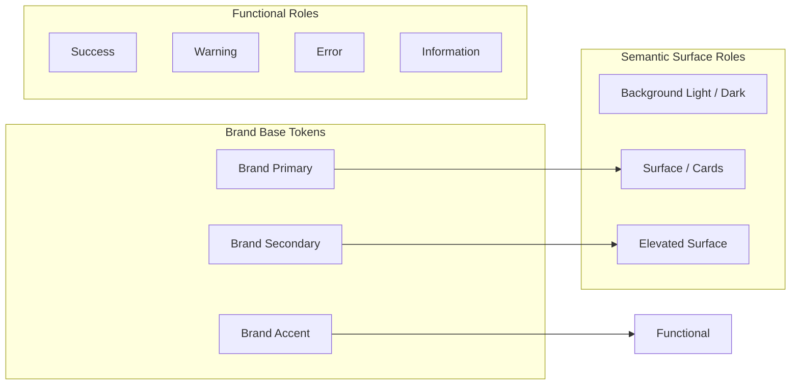

# Design Specification & Rebranding Blueprint

> **Document Type:** UI/UX & Design System Architecture  
> **Target Project:** Rebranded eCommerce Mobile & Web Application (Derived from `HomeBake`)  
> **Status:** Specification Baseline (Brand-Agnostic)  
> **Purpose:** Official design blueprint for establishing a brand-independent, modern design system while guaranteeing 100% functional equivalence with existing workflows.

---

## 1. Design Objectives

The core philosophy of this rebranding is: **Transform the visual aesthetic, elevate user delight, and modernize the design system without altering underlying business rules or data relationships.**

1. **Preserve User Workflow Integrity:** Every critical user task (account creation, catalog discovery, product customization, cart additions, checkout, order tracking, and QR verification) must remain intuitively accessible and functionally identical.
2. **Eliminate Hard-Coded Theming:** Decouple all screen layouts from arbitrary hardcoded colors (e.g., `#FF7A00`, `#3A3A3A`) and migrate to semantic design tokens.
3. **Elevate Perceived Quality:** Transition from a simplistic, prototype-like UI to a polished, premium aesthetic featuring harmonious typography, consistent spacing grids, elegant elevations, and smooth micro-interactions.
4. **Platform & Accessibility Compliance:** Comply with WCAG 2.1 AA accessibility guidelines, enforce minimum 48x48dp touch targets, support system font scaling, and provide full dark-mode compatibility.
5. **Brand-Agnostic Modularity:** Structure theme definitions using explicit placeholders (e.g., `[PRIMARY_BRAND_COLOR]`) so that any final visual identity can be applied by swapping token values.

---

## 2. Current Screen to Redesigned Screen Mapping

| Current Screen / Widget | Existing Purpose | Functional Behavior to Preserve | Proposed Modern Design Changes | Dependencies & Risks |
| :--- | :--- | :--- | :--- | :--- |
| **`SplashScreen`** (`splash_screen.dart`) | App boot, session hydration, and routing | Check `GetStorage` session; route to `/home` or `/login`. | Replace static asset with smooth animated logo fade, branded background gradient, and loading skeleton. | Must not delay routing logic or fail on corrupted storage. |
| **`LoginScreen`** (`login_screen.dart`) | Email/password authentication | Validate inputs; invoke `authViewModel.login()`; route to `/home`. | Modern glassmorphism card, subtle input borders, floating labels, password visibility toggle, clear error banners. | Form field validation regex must remain identical. |
| **`RegisterScreen`** (`register_screen.dart`) | New user account creation | Capture name, email, phone, password; create Auth user and Firestore doc. | Multi-field structured form with real-time strength indicator, terms checkbox, and progress feedback. | Must write to `Users` collection using the exact same schema. |
| **`HomeScreen`** (`home_screen.dart`) | Product discovery & category browsing | Query `categories` and `products`; hot picks carousel; navigate to detail or cart. | Dynamic hero banner carousel with micro-animations, horizontal category pills with smooth shadows, 2-column staggered product grid with badge overlays. | Stream listeners and category query filters must not be broken. |
| **`ProductDetailScreen`** (`product_detail_screen.dart`) | View product details, select options, add to cart | Read `ProductModel`; select weight/quantity; calculate unit total; invoke `cartViewModel.addToCart()`. | Edge-to-edge image gallery with pinch-to-zoom, elevated bottom action bar with quantity stepper, smooth weight chip selectors, allergen/ingredient accordion. | Selected weight and quantity parameters must strictly map to `cartViewModel.addToCart()`. |
| **`CartScreen`** (`cart_screen.dart`) | Review selected items, adjust quantities, initiate checkout | Stream items from `carts/{uid}/items`; compute subtotal; trigger `orderViewModel.placeOrder()`. | Swipe-to-delete dismissible items, animated quantity incrementors, sticky checkout footer with clear price breakdown, empty-state illustration. | **High Risk:** Must fix the un-awaited order submission and verify placement before showing success. |
| **`OrderHistoryScreen`** (`order_history_screen.dart`) | View past and active orders | Query `orders` collection where `user_id == uid`; order status badges. | Segmented tab filter (Active / Completed / Cancelled), timeline tracking card with progress indicator, order re-order CTA button. | Status string casing (`pending`, `delivered`) must match Firestore rules. |
| **`OrderDetailScreen`** (`order_detail_screen.dart`) | Full order summary & QR code verification | Render item breakdown, delivery address, and QR code for fulfillment. | Modern digital receipt layout, card-elevated QR code widget with share/download button, courier/store contact shortcut. | **Strict Preservation:** QR data string format `orderNo:${orderNo}_orderId:${orderId}` must remain exact. |
| **`ProfileScreen`** (`profile_screen.dart`) | User details & account navigation | Display name, email, address; allow profile picture upload and logout. | Clean header avatar with subtle edit badge, grouped settings card with chevron navigation, haptic logout confirmation. | Image upload must write URL to `Users/{uid}.profile_pic`. |
| **`SettingsPage`** (`settings_page.dart`) | Account preferences & legal | List of settings items (password, delete account, language, support). | Grouped grouped-list layout with distinct icon headers, native-style switches for notifications, destructive styling for account deletion. | Placeholder items must be clearly marked or gracefully disabled until business logic is attached. |
| **`OrderSuccessScreen`** (`order_success_screen.dart`) | Order confirmation feedback | Display confirmation message and order number; route back to home or orders. | Lottie/Rive celebratory checkmark animation, animated receipt card, "Track Order" and "Continue Shopping" dual CTAs. | Order number string must be passed correctly from checkout. |

---

## 3. Design System Specification

### 3.1 Semantic Color Roles



| Semantic Token Name | Light Theme Fallback | Dark Theme Fallback | Functional Role & Intended Usage |
| :--- | :--- | :--- | :--- |
| `colorScheme.primary` | `[PRIMARY_BRAND_COLOR]` (`#E85D04`) | `[PRIMARY_BRAND_DARK]` (`#FF7A29`) | Primary CTA buttons, active tab indicators, brand accents |
| `colorScheme.secondary` | `[SECONDARY_BRAND_COLOR]` (`#6A040F`) | `[SECONDARY_BRAND_DARK]` (`#A83232`) | Secondary badges, category chips, header emphasis |
| `colorScheme.tertiary` | `[ACCENT_COLOR]` (`#FFBA08`) | `[ACCENT_COLOR_DARK]` (`#FFD166`) | Rating stars, hot pick highlights, promotion banners |
| `colorScheme.surface` | `#FFFFFF` | `#1A1A1E` | Card containers, dialog backgrounds, bottom sheets |
| `colorScheme.surfaceContainer`| `#F8F9FA` | `#242429` | List item backgrounds, elevated search bars, input fills |
| `colorScheme.background` | `#F4F5F7` | `#121214` | Primary screen canvas background |
| `colorScheme.outline` | `#E0E2E7` | `#323238` | Subtle borders, input field boundaries, card dividers |
| `colorScheme.error` | `#DC2626` | `#F87171` | Validation errors, order cancellation badges, destructive alerts |
| `colorScheme.onPrimary` | `#FFFFFF` | `#121214` | Text & icon elements rendered on primary surfaces |
| `colorScheme.onSurface` | `#1E2024` | `#EDEDF0` | High-emphasis body text, card titles, prominent labels |
| `colorScheme.onSurfaceVariant`| `#6B7280` | `#9CA3AF` | Medium-emphasis secondary text, timestamps, captions |

### 3.2 Typography System

The application typography should adopt a modern Google Font pairing (e.g., `Plus Jakarta Sans` or `Outfit` for headings paired with `Inter` for body text).

| Style Token | Font Weight | Size (sp) | Line Height | Usage |
| :--- | :--- | :--- | :--- | :--- |
| `displayLarge` | Bold (700) | 32 | 40 | Splash titles, celebratory headers |
| `headlineMedium` | Semi-Bold (600) | 24 | 32 | Screen titles (Catalog, Cart, Order Details) |
| `titleMedium` | Medium (500) | 18 | 24 | Section headers, product names in cards |
| `bodyLarge` | Regular (400) | 16 | 24 | Product descriptions, terms, primary body copy |
| `bodyMedium` | Regular (400) | 14 | 20 | Subtitles, input field text, list item details |
| `labelLarge` | Semi-Bold (600) | 14 | 20 | Button labels, chip selections, tab titles |
| `labelSmall` | Medium (500) | 11 | 16 | Status badges, timestamps, helper footnotes |

### 3.3 Spacing Scale & Layout Grid

* **Base Grid Unit:** 4dp
* **Scale Tokens:**
  * `spacing.xs` = 4dp
  * `spacing.sm` = 8dp
  * `spacing.md` = 16dp (Standard mobile screen padding)
  * `spacing.lg` = 24dp (Card interior padding, section separation)
  * `spacing.xl` = 32dp (Hero banner margin, header spacing)
  * `spacing.xxl` = 48dp (Section dividing gaps)
* **Screen Edge Padding:** 16dp on mobile (<600dp); 24dp on tablets/foldables; 32dp on web containers.
* **Max Content Width (Web / Tablet):** 1120dp centered with responsive margins.

### 3.4 Elevation, Shadows, and Border Radii

* **Border Radii:**
  * Small UI (Chips, tags, small inputs): `8dp`
  * Standard Cards & Dialogs: `16dp`
  * Bottom Sheets & Action Panels: `24dp` (Top corners)
  * Full Pill Buttons: `999dp`
* **Shadow Tokens:**
  * `elevation.low`: `0px 2px 4px rgba(0, 0, 0, 0.05)` (Product cards, list tiles)
  * `elevation.medium`: `0px 8px 16px rgba(0, 0, 0, 0.08)` (Floating action buttons, bottom checkout bar)
  * `elevation.high`: `0px 16px 32px rgba(0, 0, 0, 0.12)` (Dialogs, modal overlays)

### 3.5 Interaction States & Feedback

* **Buttons:**
  * `Enabled`: Solid background with `onPrimary` text/icon.
  * `Hover / Focus (Web)`: 8% overlay tint + slight scale (1.02x).
  * `Pressed`: 12% darker tint + haptic feedback (`HapticFeedback.lightImpact()`).
  * `Disabled`: 30% opacity, no gesture handling, cursor `not-allowed`.
  * `Loading`: Inline centered circular indicator (`height: 20dp, width: 20dp`), button non-clickable.
* **Form Inputs:**
  * `Default`: `outline` border (1dp), subtle placeholder text.
  * `Focused`: `primary` border (2dp), elevated label.
  * `Error`: `error` border (1.5dp), red helper text beneath input.

---

## 4. Brand Customization Placeholders

When applying the final brand identity, the development team will substitute the following placeholders:

| Placeholder Key | Description & Role | Planned Integration Points |
| :--- | :--- | :--- |
| `[NEW_APP_NAME]` | The official consumer-facing application name | App title, splash screen, navigation header, push notifications |
| `[NEW_TAGLINE]` | Marketing slogan or value proposition | Splash screen, onboarding carousel, auth headers |
| `[LOGO_ASSET]` | Vector/SVG brand mark | Splash, app bar, login header, order success screen, app icon |
| `[PRIMARY_BRAND_COLOR]` | Signature brand primary hue | Buttons, active badges, key focus indicators, tab highlights |
| `[SECONDARY_BRAND_COLOR]` | Harmonious supporting brand hue | Secondary cards, category chips, complementary branding |
| `[ACCENT_COLOR]` | Highlight / callout tone | Special offer ribbons, rating stars, promotional banners |
| `[TYPOGRAPHY_SYSTEM]` | Selected primary and secondary fonts | `ThemeData.textTheme` (Google Fonts configuration) |
| `[ILLUSTRATION_STYLE]` | Empty state & onboarding illustration set | Empty cart, empty orders, no search results, error screens |
| `[BRAND_PERSONALITY]` | Voice & Tone (e.g., Artisanal, Modern, Warm) | Copywriting, snackbar alerts, success confirmations |

---

## 5. Screen-by-Screen Design Requirements

### 5.1 Authentication Screens (Login & Register)
* **Information Hierarchy:**
  1. Branded Header (`[LOGO_ASSET]` + `[NEW_APP_NAME]` + Welcome Subtitle)
  2. Input Card (Email, Password, Name for Registration)
  3. Action CTA (Full-width Primary Button)
  4. Alternate Action Link ("Don't have an account? Sign Up" / "Forgot Password?")
* **Feedback & States:** Inline field validation errors; non-blocking progress spinner over primary button; animated toast/snackbar on network error.
* **Preservation Rule:** Form controllers must retain identical validation rules and pass exact credential strings to `AuthViewModel`.

### 5.2 Home Dashboard (`HomeScreen`)
* **Layout Structure:**
  * Sticky App Bar: Location/Greeting, Search icon, and Cart Badge counter.
  * Promotional Carousel: Auto-advancing slider with smooth indicator dots.
  * Category Pills: Horizontally scrolling chips with category icon + label.
  * Section Headers: "Popular Treats" / "Today's Specials" with a "See All" link.
  * Product Grid: Responsive 2-column card grid with heart/wishlist badge, image, title, price, and quick "Add" button.
* **States:** Shimmer skeleton cards during Firestore stream hydration; empty search state with illustration.

### 5.3 Product Detail Screen (`ProductDetailScreen`)
* **Layout Structure:**
  * Hero Image Header: Full-width carousel with page dots and floating back/share buttons.
  * Header Info: Product title, category chip, customer rating, price display.
  * Customization Selector: Weight / Size option chips (e.g., "500g", "1kg", "2kg") with dynamic price updates.
  * Description & Details: Expandable product description and dietary tags.
  * Floating Bottom Action Bar: Quantity decrement/increment stepper (`- 1 +`) + "Add to Cart" CTA.
* **Preservation Rule:** Invocation must pass `selectedWeight` and `quantity` to `CartViewModel.addToCart()`.

### 5.4 Cart & Checkout Screen (`CartScreen`)
* **Layout Structure:**
  * Scrollable Item List: Dismissible item tiles showing thumbnail, title, weight, line price, and quantity stepper.
  * Order Summary Card: Item subtotal, delivery fee calculation, and grand total.
  * Sticky Footer: Grand total display + "Place Order" full-width CTA.
* **Critical Design & Logic Update:** 
  * Replace immediate un-awaited navigation with a proper modal loading barrier (`showDialog` with spinner).
  * Await `orderViewModel.placeOrder()`.
  * Navigate to `AppRoutes.success` **only upon verified success**; show error snackbar upon failure.

### 5.5 Order Detail & QR Verification Screen (`OrderDetailScreen`)
* **Layout Structure:**
  * Order Status Hero: Color-coded status badge (`Pending`, `Processing`, `Delivered`, `Cancelled`) with estimated delivery time.
  * QR Code Presentation Card: Prominently centered QR code with subtle card shadow, order reference number (`#HB-XXXX`), and instruction: "Present this QR code upon pickup or delivery."
  * Order Breakdown: Itemized list of ordered products, prices, and quantities.
  * Delivery & Payment Details: Destination address, customer phone, and payment status.
* **Strict Constraint:** QR data string must strictly adhere to `orderNo:${orderNo}_orderId:${orderId}`.

---

## 6. Separation of Visual Design and Application Logic

To ensure the rebranding proceeds safely without breaking backend contracts, the architectural layers must remain strictly decoupled:

```mermaid
graph TD
    subgraph Brand & Design Layer
        BT[Brand Assets & Logos]
        DT[Design Tokens & Theme Data]
        CW[Custom Common Widgets\n(AppButton, AppTextField, ProductCard)]
    end

    subgraph Screen Presentation Layer
        SV[Screen Views\n(HomeScreen, CartScreen, etc.)]
    end

    subgraph Logic & State Layer
        VM[Existing ViewModels\n(AuthViewModel, CartViewModel, etc.)]
    end

    subgraph Data & Backend Layer
        FS[FirebaseServices & Firestore Collections]
        GS[GetStorage Key-Value Store]
    end

    BT --> DT
    DT --> CW
    CW --> SV
    SV --> VM
    VM --> FS
    VM --> GS
```

* **Rules for Developers & Agents:**
  1. Screens must **never** call `FirebaseFirestore.instance` directly; all actions must route through existing ViewModels.
  2. All styling (colors, fonts, radii, borders) must query `Theme.of(context)` or reference the central design system tokens.
  3. No business logic (e.g., cart total calculations or status transitions) may be embedded inside UI widgets.
