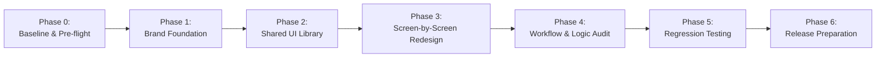

# Implementation Plan & Rebranding Execution Blueprint

> **Document Type:** Phased Engineering Migration & Rebranding Roadmap  
> **Target Project:** Rebranded Flutter Application (from `HomeBake` baseline)  
> **Status:** Implementation Baseline  
> **Guiding Principle:** **Strict Functional Preservation with Decoupled Visual Redesign.**

---

## 1. Implementation Strategy & Phased Roadmap

The rebrand must proceed in strict sequential phases to guarantee zero regression in critical shopping, checkout, and order-tracking functionality.

### Phase 0: Baseline & Preparation
* **Goal:** Capture current functional baseline, establish rollback points, and isolate existing defects.
* **Key Tasks:**
  1. Record current Git commit hash (`origin/dev`) as the reference safety checkpoint.
  2. Document known baseline issues (e.g., un-awaited order submission in `CartScreen`, client-side service account in `.env`) so they are not mistaken for redesign regressions.
  3. Ensure clean Flutter build on Android, iOS, and Web.

### Phase 1: Brand Foundation & Design System Setup
* **Goal:** Introduce semantic design tokens, fonts, and assets without touching any screen layouts.
* **Key Tasks:**
  1. Add new brand assets to `assets/images/` and `assets/icons/` without deleting legacy assets prematurely.
  2. Restructure `lib/core/app_theme.dart` with semantic Material 3 `ColorScheme` tokens (`primary`, `secondary`, `surface`, `onPrimary`, etc.).
  3. Configure typography using Google Fonts (e.g., `Plus Jakarta Sans` or `Outfit`).
  4. Create `lib/core/theme/app_dimensions.dart` defining standard paddings (4, 8, 16, 24, 32) and border radii (8, 16, 24).

### Phase 2: Shared UI Component Library
* **Goal:** Restyle or create reusable UI components in `lib/widgets/` preserving exact callback signatures.
* **Key Tasks:**
  1. Update `AppButton` / `CustomButton` (supports loading state, disabled state, primary/secondary variants).
  2. Update `AppTextField` / `CustomTextField` (handles prefix/suffix icons, obscure text, validation error text).
  3. Create `ProductCard` (standardized 2-column card with image cache, discount chip, and add-to-cart callback).
  4. Create `StateBanner` / `EmptyStateWidget` (unified empty and error state presentations).

### Phase 3: Screen-by-Screen Incremental Redesign
* **Goal:** Restructure screens one by one, keeping all ViewModel bindings intact.
* **Sequence:**
  1. **Splash & Auth:** `SplashScreen` $\rightarrow$ `LoginScreen` $\rightarrow$ `RegisterScreen` $\rightarrow$ `ForgotPasswordScreen`.
  2. **Core Browsing:** `HomeScreen` $\rightarrow$ Category Carousel $\rightarrow$ `ProductDetailScreen`.
  3. **Cart & Fulfillment:** `CartScreen` (fix un-awaited checkout flow here) $\rightarrow$ `OrderSuccessScreen`.
  4. **Orders & Verification:** `OrderHistoryScreen` $\rightarrow$ `OrderDetailScreen` (strictly preserve QR code payload).
  5. **Profile & Preferences:** `ProfileScreen` $\rightarrow$ `SettingsPage`.

### Phase 4: Workflow Integration & Fragility Remediation
* **Goal:** Validate end-to-end user journeys and resolve identified technical fragilities.
* **Key Tasks:**
  1. Verify `CartScreen` properly awaits `orderViewModel.placeOrder()` before navigating to `AppRoutes.success`.
  2. Audit `CartViewModel.updateInventory()` and attach it to verified order placement if approved.
  3. Verify `OrderDetailScreen` QR code continues to encode `orderNo:${orderNo}_orderId:${orderId}`.
  4. Verify push notification subscriptions to topic `orders` and token syncing to `Users/{uid}`.

### Phase 5: Regression Testing & Acceptance Validation
* **Goal:** Execute comprehensive functional tests across mobile and web environments.
* **Key Tasks:**
  1. Run unit tests on ViewModels (`CartViewModel`, `AuthViewModel`, `OrderViewModel`).
  2. Validate touch targets, contrast ratios, and font-scaling behavior.
  3. Verify offline/error state handling when network is disconnected.

### Phase 6: Brand Application & Release Preparation
* **Goal:** Finalize identity assets, application package metadata, and platform builds.
* **Key Tasks:**
  1. Update app display name in Android (`AndroidManifest.xml` label) and iOS (`CFBundleDisplayName`).
  2. Generate native app launcher icons using `flutter_launcher_icons`.
  3. Validate release build flags and verify clean release APK/AAB and iOS archive generation.

---

## 2. File-Level Implementation Map

| File Path | Current Responsibility | Planned Action | Detailed Reason | Risk Level |
| :--- | :--- | :--- | :--- | :--- |
| `lib/main.dart` | App initialization, `MultiProvider`, Firebase setup | **RESTYLE / KEEP** | Keep providers intact; update `MaterialApp` title, theme bindings, and route table. | Low |
| `lib/core/app_routes.dart` | Central route registry & route generation | **KEEP** | Maintain exact named route strings (`/`, `/home`, `/cart`, etc.) to prevent navigation breaks. | Low |
| `lib/core/app_theme.dart` | Theme configuration and colors | **REPLACE** | Replace hard-coded color palette with semantic Material 3 tokens. | Medium |
| `lib/core/services/firebase_services.dart` | Firebase Auth and Firestore CRUD wrapper | **KEEP** | Encapsulates backend interaction; must remain completely intact. | High |
| `lib/core/services/notification_service.dart` | FCM push token & local notifications | **KEEP / REFACTOR**| Retain notification listener contracts; migrate client FCM v1 token generation to backend when feasible. | High |
| `lib/features/auth/view_model/auth_view_model.dart` | Login, registration, password reset logic | **KEEP** | Core business logic and validation; zero modification required. | High |
| `lib/features/auth/view/login_screen.dart` | Login UI and form inputs | **RESTYLE** | Modernize form layout and typography; keep form controllers and `authViewModel.login()`. | Medium |
| `lib/features/auth/view/register_screen.dart` | Registration UI and input fields | **RESTYLE** | Modernize registration form; keep `authViewModel.register()` call and field mapping. | Medium |
| `lib/features/home/view_model/home_view_model.dart` | Category and product stream queries | **KEEP** | Handles Firestore queries; keep unchanged. | High |
| `lib/features/home/view/home_screen.dart` | Catalog dashboard, banner slider, product grid | **RESTYLE** | Redesign hero carousel, category pills, and product grid; maintain ViewModel calls. | Medium |
| `lib/features/products/view/product_detail_screen.dart`| Product details, weight selection, add to cart | **RESTYLE** | Implement edge-to-edge gallery, chips, and sticky footer; keep `cartViewModel.addToCart()`. | Medium |
| `lib/features/cart/view_model/cart_view_model.dart` | Cart subtotal, quantity updates, inventory logic | **KEEP / REFACTOR**| Preserve subtotal math; link `updateInventory()` upon order placement. | High |
| `lib/features/cart/view/cart_screen.dart` | Cart items, totals, checkout CTA | **REFACTOR** | Redesign item tiles; **fix un-awaited checkout**; show progress dialog before `/success`. | High |
| `lib/features/orders/view_model/order_view_model.dart` | Order placement, history query, FCM notification| **KEEP** | Preserves `orders` document structure and history retrieval. | High |
| `lib/features/orders/view/order_history_screen.dart` | Historical orders list | **RESTYLE** | Modernize status badges and card elevation; keep Firestore query bindings. | Low |
| `lib/features/orders/view/order_detail_screen.dart` | Order receipt & QR code rendering | **RESTYLE** | Digital receipt styling; **strictly preserve QR encoding string format**. | High |
| `lib/features/profile/view/profile_screen.dart` | User profile details, image picker | **RESTYLE** | Elevate avatar UI and settings tiles; keep image upload and update methods. | Low |
| `lib/features/settings/view/settings_page.dart` | Settings hub (currently placeholders) | **RESTYLE / ADD** | Redesign grouped tile layout; clearly mark non-functional items or wire up password dialog. | Low |
| `lib/widgets/custom_button.dart` | Shared button widget | **REPLACE** | Replace with `AppButton` supporting semantic themes, haptics, and loading indicators. | Low |
| `lib/widgets/custom_text_field.dart` | Shared text input widget | **REPLACE** | Replace with `AppTextField` supporting floating labels, clear icons, and theme borders. | Low |
| `test/widget_test.dart` | Default test placeholder | **REPLACE** | Replace with comprehensive ViewModel and widget tests. | Low |

---

## 3. Explicit Preservation Requirements (Do Not Alter)

The following architectural and data contracts are **strictly immutable** during the rebranding process:

| Category | Contract / Specification | Reason for Immutability |
| :--- | :--- | :--- |
| **Firestore Collections** | `Users`, `categories`, `products`, `orders`, `carts/{uid}/items` | Any alteration breaks backend queries, existing user records, and administrative dashboards. |
| **Model Serialization** | Attribute keys (`product_name`, `price`, `selected_weight`, `order_no`, etc.) | Required by Firestore serialization in `toMap()` / `fromMap()`. |
| **Named Routes** | `AppRoutes.splash`, `AppRoutes.login`, `AppRoutes.home`, `AppRoutes.cart`, `AppRoutes.orders`, `AppRoutes.productDetail`, `AppRoutes.orderDetail` | Navigation calls across existing ViewModels and notifications rely on these exact paths. |
| **Local Storage Keys** | `is_logged_in`, `user_id`, `user_email`, `user_name` in `GetStorage` | Altering keys would instantly log out existing active sessions upon upgrade. |
| **QR Code Encoding** | `orderNo:${orderNo}_orderId:${orderId}` | Merchant and delivery scanner applications expect this exact string format. |
| **FCM Topic** | `orders` | Administrative consoles and notification listeners listen specifically to this topic. |
| **ViewModel Signatures** | `addToCart(ProductModel, int, String)`, `placeOrder(...)`, `login(String, String)` | UI widgets communicate exclusively through these contract methods. |

---

## 4. Testing & Acceptance Criteria Matrix

| Feature / Workflow | Baseline Behavior | Post-Redesign Test Requirement | Acceptance Criteria (Measurable) |
| :--- | :--- | :--- | :--- |
| **User Authentication** | User inputs email/password; logs in; session cached in `GetStorage`. | Unit test `AuthViewModel.login()`; test UI form error states. | Valid credentials navigate to `/home`; session restores upon app reboot; invalid credentials show error banner. |
| **Catalog Browsing** | Products and categories stream from Firestore into horizontal/vertical lists. | Verify category filter chips and hot picks display on mobile/web. | All active categories render; tapping a category filters the product list accurately. |
| **Add to Cart** | Item with weight option is added; document written to `carts/{uid}/items`. | Verify weight selector, quantity stepper, and cart counter update. | Cart badge increments; Firestore subcollection doc contains exact `selected_weight` and `quantity`. |
| **Cart Subtotal Calculation** | Subtotal calculated as sum of (`price * quantity`). | Unit test `CartViewModel.calculateTotal()`. | Subtotal and grand total match exact penny/cent values; empty cart shows empty state graphic. |
| **Checkout & Order Placement** | User taps "Place Order"; doc created in `orders`; navigates to `/success`. | Verify asynchronous order completion before navigation. | Order doc appears in Firestore with `status: "pending"`; app navigates to `/success` **only after** Firestore write confirms. |
| **QR Code Verification** | `OrderDetailScreen` renders QR code containing order identifiers. | Scan rendered QR code with third-party scanner application. | Scanned text matches pattern `orderNo:<NO>_orderId:<ID>` identically. |
| **Order History & Status** | Orders display categorized by date and status (`pending`, `delivered`). | Verify list rendering with diverse order statuses. | All user orders display correctly with corresponding color-coded status badges. |

---

## 5. Risk Management & Rollback Strategy

### 5.1 High-Risk Areas
1. **Un-Awaited Checkout Flow in `CartScreen`:**
   * *Risk:* Navigating to `/success` without awaiting `placeOrder()` can lead to silent order failures (e.g., if the user is offline).
   * *Mitigation:* Wrap `placeOrder()` in a try-catch, display a blocking progress barrier, and only navigate on confirmation.
2. **QR Code Breaking:**
   * *Risk:* Modifying the QR widget formatting will break delivery driver scanning.
   * *Mitigation:* Unit test the QR string generator and verify with physical barcode scanning.
3. **Hardcoded Color Leaks:**
   * *Risk:* Overlooking hardcoded color hex values causes invisible text in dark mode.
   * *Mitigation:* Conduct codebase search for `Color(0x` or `Colors.` and replace with `Theme.of(context).colorScheme.*`.

### 5.2 Rollback Checkpoints & Git Strategy
* **Branching Strategy:** Work strictly on a dedicated feature branch (e.g., `feature/brand-redesign`) branching off `dev`.
* **Atomic Commits:** Commit after each completed phase:
  * `chore(theme): introduce brand tokens and typography system`
  * `feat(widgets): implement modern AppButton and AppTextField`
  * `feat(screens): restyle HomeScreen and Catalog components`
  * `fix(cart): ensure awaited order placement and restyle CartScreen`
* **Fast Rollback:** If a regression is discovered in a redesigned screen, the specific view file can be checked out from `dev` (`git checkout dev -- lib/features/<module>/view/`) without impacting ViewModels or backend logic.

---

## 6. Definition of Done (DoD)

The rebranding task is considered complete **only** when all of the following conditions are satisfied:

1. **Consistent Visual Transformation:** All screens adopt the semantic design system tokens with zero hardcoded legacy brand colors.
2. **100% Functional Equivalence:** Users can log in, browse products, add customized items to cart, check out, view order history, and display valid QR codes.
3. **Preserved Data Contracts:** All Firestore collections, document structures, and serialization keys remain untouched and fully compatible.
4. **Resolved Fragilities:** Checkout in `CartScreen` is verified to await backend order creation before navigating to confirmation.
5. **No Regressions in Multiplatform Builds:** The application compiles without warnings on Android (API 23–36), iOS, and Web.
6. **Accessibility & Usability:** All interactive components meet the 48x48dp minimum touch target and pass contrast standards in both light and dark themes.
7. **Passing Regression Tests:** All unit and widget tests pass successfully.
8. **Documentation Fidelity:** Code changes strictly adhere to `app_overview.md`, `design.md`, and this `implementation.md`.
